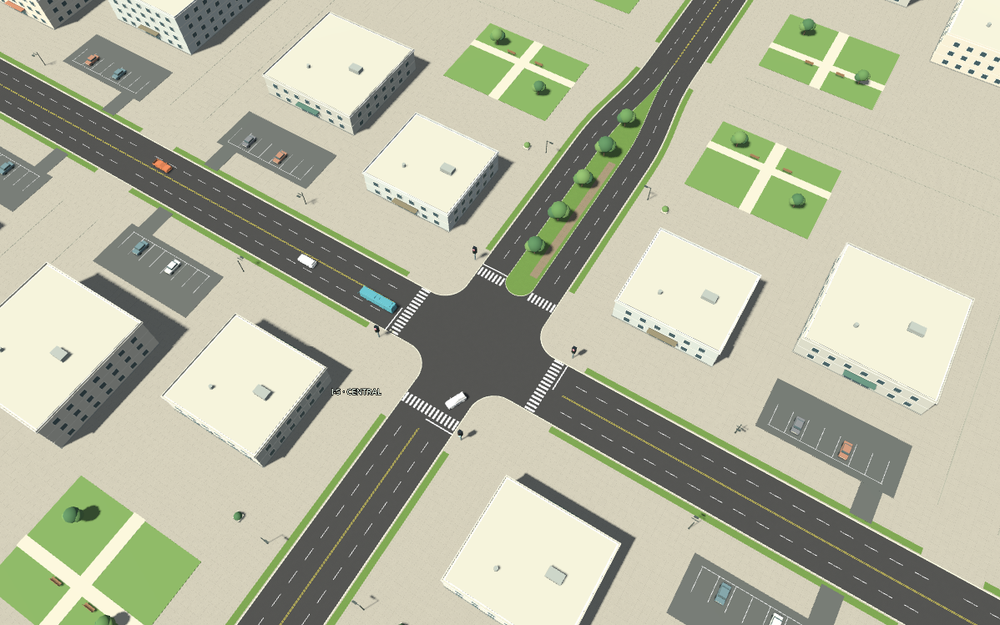

# Calzada 3D basada en Cruce_Calles.png

La imagen de `calle/Cruce_Calles.png` se utiliza ahora para reconstruir el trazado de la calle. El visor del plano se conserva como comparación auxiliar. La escena principal contiene geometría 3D vial, vegetación y arquitectura.

## Correspondencia con la imagen

| Rasgo de la referencia | Implementación en la escena |
| --- | --- |
| Avenida norte dividida | Acceso norte de I-5 ensanchado a 21 m, con mediana de 7 m, sendero y cinco árboles. |
| Calles de cuatro carriles | Dos carriles demarcados por sentido, de 3,5 m. La demo circula por el interior; el exterior queda disponible para la futura ampliación de tráfico. |
| Esquinas redondeadas | Superficies de acera y bordillos con radio de 6 m. |
| Cebras y líneas de detención | Pasos de cebra a 18 m y detención a 20 m del centro. |
| Doble amarilla y líneas discontinuas | Marcas geométricas en el asfalto, con continuidad entre sectores. |
| Bandas verdes y entorno | Franjas ajardinadas, edificios bajos con fachadas, estacionamientos, jardines, bancos y farolas. |

Las dimensiones son una adaptación métrica para la demo, porque la imagen no incluye escala. Se reconstruyen sus rasgos viales; los edificios y el mobiliario constituyen una interpretación urbana y no un levantamiento exacto de cada parcela. La mediana se estrecha al final del sector para mantener la conexión con la red de nueve cruces.

## Geometría y circulación comparten el perfil

`road_profile.gd` define el carril activo, la mediana, el estrechamiento, las líneas de detención y el inicio de los giros. La lógica usa ese perfil para colocar y mover cada vehículo. Las zonas visibles de detección siguen la misma curva.

Se ajustaron las trayectorias con entradas y salidas de distinto desplazamiento lateral para el bulevar norte. Se comprueba el perímetro completo del bus de 9,4 × 2,5 m a lo largo de los giros y del estrechamiento contra el polígono de asfalto, la mediana y los bordillos.

El cambio a carriles más estrechos también reveló una falsa detección de líder al terminar un giro cerca de un vehículo del sentido contrario. Se corrigió el criterio de seguimiento y se conservan las comprobaciones SAT y la reserva de cruce. La prueba de red exige progreso en la segunda mitad de cada ensayo para detectar bloqueos.

## Presentación

La escena abre en I-5, con edificios sólidos y zonas de diagnóstico ocultas. La transparencia y las zonas siguen disponibles en sus controles. **F1** alterna el panel lateral; **F2** oculta la interfaz para recorrer o presentar el diseño. Botón derecho para orbitar y rueda para zoom.

El entorno se agrupa por materiales para contener las llamadas de dibujo. Incluye 72 edificios bajos con ventanas y cubiertas, 77 árboles, 72 farolas, 72 bancos, 72 autos de fondo y 288 plazas de estacionamiento. El asfalto y las aceras usan una variación procedural suave, sin modificar la imagen original.

## Comprobaciones

- `test_road_profile.gd`: rutas, tangentes, bus sobre el asfalto, separación de mediana/bordillos, franja de sensores y detención en la nueva línea.
- `test_reference_scene.gd`: geometría vial, mediana, entorno, correspondencia de detención, zonas, transparencia y modo presentación.
- `test_network.gd`: seguridad, transferencia de vehículos y progreso sostenido en FTI, adaptativo y fijo, además de los escenarios de hora punta.
- Continúan las pruebas del controlador, interfaz y flota. El control mantiene la referencia de 14.400 estados de JavaScript.

Las capturas de esta página se obtuvieron del renderizador real de Godot. La referencia PNG original y los tres STL se conservan sin modificaciones.
