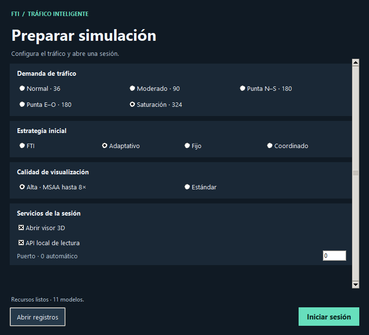

# GodotProyecto · Variante experimental con Whisk3D y Python

**Versión experimental en desarrollo.** Esta rama reúne una variante del
simulador de semáforos inteligentes con Python para la lógica y Whisk3D para
la visualización. Tiene funciones pendientes y requiere más validación antes
de un despliegue de producción.

La rama `experimental/whisk-python-api` parte de `main` en
`dc095ef63e341260c94e20d2202a267770534333`. El código de esta variante está en
[`variantes/whisk-python/`](variantes/whisk-python/). El proyecto Godot de
referencia y su documentación siguen disponibles en [README-GODOT.md](README-GODOT.md).

## Probar la variante

En Windows de 64 bits, abre
[`variantes/whisk-python/INICIAR-FTI.pyw`](variantes/whisk-python/INICIAR-FTI.pyw)
con Python 3.10 o superior y Tkinter. El launcher permite elegir escenario,
estrategia, calidad gráfica y servicios de datos. Después pulsa **Iniciar
sesión**. Las instrucciones completas están en
[la guía de ejecución](variantes/whisk-python/LEEME.md).

## Funciones implementadas

- Red de nueve cruces calculada en Python, con el cruce I-5 visible en Whisk3D.
- Estrategias FTI, adaptativa, fija y coordinada, con fases de amarillo y
  despeje, sensores virtuales, respaldo ante fallo y solicitud peatonal.
- Cinco perfiles de demanda hasta 324 vehículos en la red y modo manual
  de 0 a 36 vehículos en I-5.
- Once modelos, incluida la moto y dos buses distintos. Orientación frontal,
  tapas de rueda, materiales y texturas compartidas revisados.
- Panel redimensionable, cámaras, pausa, reinicio, recuperación del visor y
  avance de un paso para depuración.
- Registro y exportación CSV/JSON, API local de lectura y conector HTTP
  configurable para publicar datos en un servidor.
- API de servidor con FastAPI, persistencia SQLite, deduplicación de entregas,
  token de lectura opcional y orígenes web configurables.

## Documentación

| Guía | Contenido |
| --- | --- |
| [Variante Whisk](variantes/whisk-python/README.md) | Requisitos, entrada y mapa de archivos |
| [Ejecución y controles](variantes/whisk-python/LEEME.md) | Launcher, tráfico, cámara y datos |
| [Arquitectura](variantes/whisk-python/docs/ARQUITECTURA.md) | Módulos, flujo de datos, lenguajes y herramientas |
| [Estado y pendientes](variantes/whisk-python/docs/ESTADO-Y-PENDIENTES.md) | Alcance actual, limitaciones y ampliaciones |
| [Pruebas](variantes/whisk-python/docs/PRUEBAS.md) | Comandos, resultados y límites de la validación |
| [Integración de datos](variantes/whisk-python/API.md) | Contrato JSON, consultas y extensión del módulo |
| [API de servidor](variantes/whisk-python/servidor/LEEME.md) | Dependencias, configuración, tokens y despliegue |
| [Procedencia y licencias](variantes/whisk-python/NOTICE.md) | Whisk3D, componentes y recursos |
| [Visor modificado](variantes/whisk-python/docs/VISOR-WHISK.md) | Revisión base y parche del motor |

## Lenguajes y herramientas

| Tecnología | Uso |
| --- | --- |
| Python | Simulación, launcher, interfaz, telemetría, API y conversión de modelos |
| Tkinter y Tcl/Tk | Interfaz de escritorio y diálogos |
| Lua | Recepción de instantáneas, interpolación y actualización visual |
| C++ | Visor Whisk3D y sus ajustes de integración |
| OpenGL y SDL2 | Renderizado y ventana nativa |
| FastAPI y Uvicorn | Servicio de recepción y consulta de datos |
| SQLite | Último estado, historial y control de entregas |
| HTTP, JSON y CSV | Intercambio y exportación |
| STL, OBJ/MTL y PNG | Mallas, materiales y texturas |
| Git, PowerShell, CMake, Ninja y MSVC | Desarrollo, comprobaciones y compilación del visor |

## Trabajo pendiente

La evaluación de rendimiento en otros equipos, el despliegue HTTPS en un
servidor concreto, la ampliación de la escena visible a toda la red y la
mejora progresiva de los modelos forman parte del trabajo futuro. La
circulación es cinemática y la comprobación de colisiones se ha ejercitado en
escenarios de prueba. Los resultados registrados corresponden a la revisión
documentada y a sus muestras.

El detalle de las capacidades existentes y de las funciones por completar
está en [Estado y pendientes](variantes/whisk-python/docs/ESTADO-Y-PENDIENTES.md).
