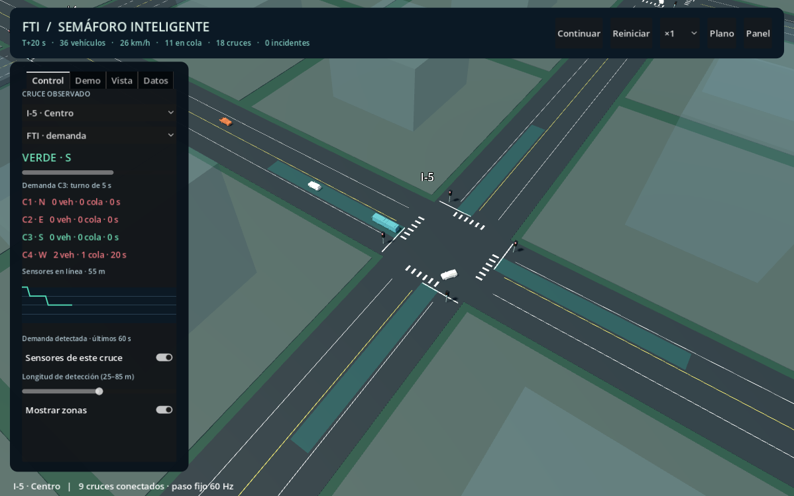

# GodotProyecto · Semáforo inteligente

Demo 3D en **Godot 4.7.2**, con nueve cruces conectados y los modelos STL de SUV, pickup y bus. Integra las funciones de control y diagnóstico del simulador HTML v3 en un núcleo GDScript independiente de la vista.

## Ejecutar

Importa `project.godot` en Godot y pulsa **F5**. Los recursos están incluidos. Para ejecutar la demo no necesitas Python, Node ni conexión a Internet.



## Funciones de la demo

- **Red 3 × 3 real:** los vehículos circulan entre cruces, conservan su identidad y frenan también ante vehículos del sector vecino.
- **FTI, adaptativo y fijo**, con amarillo y despeje antes de cambiar el verde. El controlador conserva la paridad con 14.400 estados del JavaScript original.
- **Sensores por acceso**, colas, espera, profundidad ajustable de 25–85 m, fallos por cruce o globales y respaldo fijo tras 5 s sin lecturas.
- **V2I temporal**, con transiciones seguras y cancelación automática a los 20 s. La solicitud de prueba se activa desde la pestaña Demo.
- **Escenarios reproducibles:** normal (36 vehículos), hora punta por eje (54), ausencia de demanda e incidente con recuperación a los 12 s.
- **Comparación de algoritmos:** ejecuta los tres modos durante 120 s con la misma flota y escenario en una red independiente. Conserva la demo visible y permite cancelar.
- **Telemetría y exportación:** historial de demanda, registro de eventos, métricas CSV, configuración JSON y CSV de comparación.
- **Vista libre, seguimiento y vista de red**, edificios transparentes, zonas de detección y volúmenes de colisión.
- **Inspector de la flota:** muestra los tres STL y pausa la ciudad; al salir recupera su estado anterior.
- **Paso fijo de 60 Hz**, velocidades ×0,5/×1/×2/×4, interpolación y señalización agrupada con MultiMesh para reducir llamadas de dibujo.

Consulta [DEMO-INTELIGENTE.md](DEMO-INTELIGENTE.md) para el recorrido de presentación, las pruebas y el alcance.

## Controles

Botón derecho: orbitar. Rueda: zoom. Inicio: centrar el cruce observado. Espacio: pausa. F1: alternar el panel. Esc: cerrar plano/inspector o cancelar comparación. Las pestañas **Control**, **Demo**, **Vista** y **Datos** reúnen los controles de la aplicación.

## Pruebas

Con Godot en `PATH`:

```sh
godot --headless --editor --import --path .
godot --headless --path . --script res://tests/test_controller.gd
godot --headless --path . --script res://tests/test_world.gd
godot --headless --path . --script res://tests/test_network.gd
godot --headless --path . --script res://tests/test_demo.gd
godot --headless --path . --script res://tests/test_fleet.gd
```

El puente MCP y sus pruebas requieren Python 3.10 o posterior, sin paquetes adicionales:

```sh
python tools/test_mcp.py --integration
```

Si Godot no está en `PATH`, define `GODOT_PATH` con el ejecutable principal. En PowerShell puedes ejecutar los comandos directos con `& $env:GODOT_PATH`.

## Código

| Archivo | Responsabilidad |
| --- | --- |
| `scripts/traffic_controller.gd` | Modos y fases de los semáforos; lógica determinista conservada. |
| `scripts/traffic_world.gd` | Seguimiento, frenado, reserva y circulación dentro de cada cruce. |
| `scripts/network_world.gd` | Nueve cruces, transferencias, escenarios, métricas y exportación. |
| `scripts/demo_view.gd` | Interfaz, ciudad, cámaras, diagnóstico e inspección. |
| `scripts/traffic_math.gd` | Trayectorias por distancia de arco y comprobaciones SAT. |
| `scripts/fleet_catalog.gd` | Rutas, dimensiones y colores compartidos por vista y tráfico. |
| `scripts/stl_fleet.gd` | Lectura y normalización de los STL originales. |
| `tools/` | [Puente MCP opcional](CONEXION-MCP.md) y simulaciones headless. |

Para añadir vehículos en el futuro, incorpora su STL binario y una entrada al catálogo. Comprueba dimensiones y orientación con las pruebas de flota antes de ampliar la circulación.

## Alcance

Un carril por sentido y reserva exclusiva de un vehículo por cruce. El tráfico es cinemático y usa SAT para impedir invasiones; no simula suspensión ni daños físicos. El plano PNG es una referencia consultable y no sustituye la calzada. Quedan fuera de esta demo la conducción manual, peatones, cambios de carril, paradas de bus y animación independiente de ruedas. Los modelos usan materiales sólidos, sin texturas UV nuevas.
