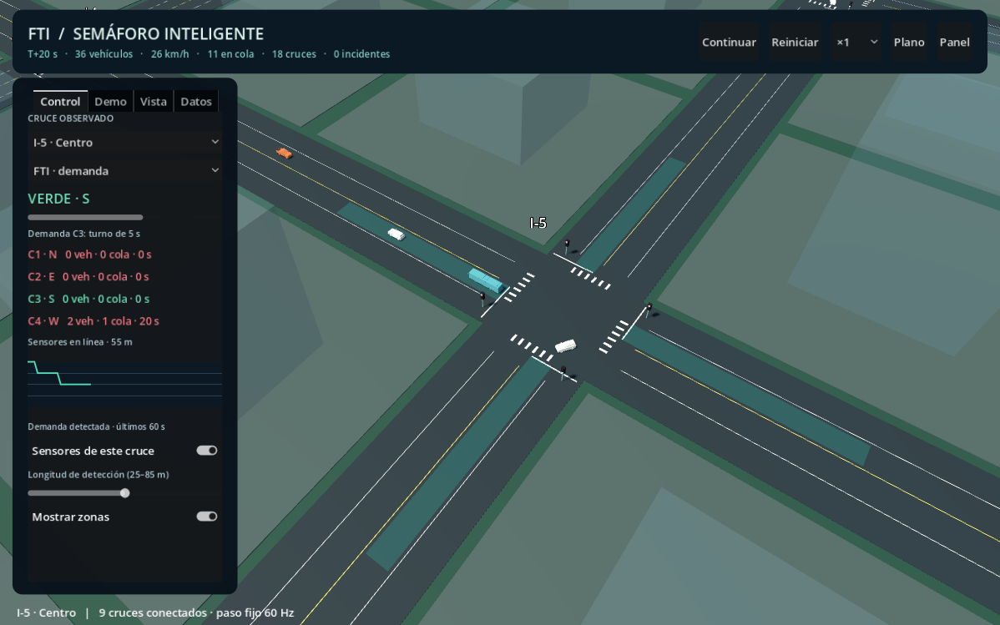

# GodotProyecto · Semáforo inteligente

Demo 3D en **Godot 4.7.2**, con nueve cruces conectados y los modelos STL de SUV, pickup y bus. Integra las funciones de control y diagnóstico del simulador HTML v3 en un núcleo GDScript independiente de la vista.

[Resumen de los cambios y su validación](RESUMEN-CAMBIOS.md).

## Ejecutar

Importa `project.godot` en Godot y pulsa **F5**. Los recursos están incluidos. La demo base no necesita Python, Node ni conexión a Internet; el coordinador opcional requiere Python 3.



## Funciones de la demo

- **Red 3 × 3 real:** los vehículos circulan entre cruces, conservan su identidad y frenan también ante vehículos del sector vecino.
- **FTI, adaptativo y fijo**, con amarillo y despeje antes de cambiar el verde. El controlador conserva la paridad con 14.400 estados del JavaScript original.
- **Sensores por acceso**, colas, espera, profundidad ajustable de 25–85 m, fallos por cruce o globales y respaldo fijo tras 5 s sin lecturas.
- **V2I temporal**, con transiciones seguras y cancelación automática a los 20 s. La solicitud de prueba se activa desde la pestaña Demo.
- **Escenarios reproducibles:** normal (36 vehículos), hora punta por eje (54), ausencia de demanda e incidente con recuperación a los 12 s.
- **Demanda configurable por calle:** introduce cuántos vehículos llegan desde Norte, Este, Sur y Oeste. Aplicar la demanda agrega los que caben y activa Python automáticamente.
- **Flujo paralelo:** sentidos opuestos compatibles comparten el verde adaptativo y atraviesan el cruce a la vez; los giros conservan reserva exclusiva para evitar colisiones. Los accesos incompatibles nunca reciben verde simultáneo.
- **Coordinador local en Python:** cada 2,5 s analiza colas, esperas y congestión aguas abajo de los nueve cruces, y pide prioridades adaptativas sin saltarse las transiciones seguras. Requiere Python 3; no usa Internet ni controla hardware.
- **Comparación de algoritmos:** ejecuta los tres modos durante 120 s con la misma flota y escenario en una red independiente. Conserva la demo visible y permite cancelar.
- **Telemetría y exportación:** historial de demanda, registro de eventos, métricas CSV, configuración JSON y CSV de comparación.
- **Envío a la web:** el cruce central I-5 se informa al panel web como `maqueta-01`: un latido por segundo, cada cambio de etapa con el motivo del corte y el conteo por minuto, acceso y tipo de vehículo. Si la web no responde, los datos esperan en una cola local y se reenvían. Solo se informa a velocidad ×1, porque las fechas usan el reloj real. Ver [Envío a la web](#envío-a-la-web).
- **Demanda abierta:** el escenario «Demanda abierta · perfil horario» deja de reciclar la flota. Los vehículos llegan por las 12 entradas del borde con llegadas aleatorias de semilla fija (70 % autos, 22 % camionetas, 8 % buses) y salen por el borde opuesto. La intensidad sigue la hora local del equipo, con puntas de mañana y tarde.
- **Calle reconstruida desde el PNG:** avenida norte dividida, mediana arbolada, bordillos curvos, cebras y doble amarilla, con rutas y sensores alineados.
- **Entorno urbano:** edificios bajos con fachadas, jardines, estacionamientos, árboles, farolas y bancos.
- **Vista libre, seguimiento y vista de red**, transparencia opcional, zonas de detección, volúmenes de colisión y presentación sin interfaz con F2.
- **Inspector de la flota:** muestra los tres STL y pausa la ciudad; al salir recupera su estado anterior.
- **Paso fijo de 60 Hz**, velocidades ×0,5/×1/×2/×4, interpolación y señalización agrupada con MultiMesh para reducir llamadas de dibujo.

La reconstrucción vial se detalla en [CALLE-DESDE-REFERENCIA.md](CALLE-DESDE-REFERENCIA.md).

Consulta [DEMO-INTELIGENTE.md](DEMO-INTELIGENTE.md) para el recorrido de presentación, las pruebas y el alcance.

## Controles

Botón derecho: orbitar. Rueda: zoom. Inicio: centrar el cruce observado. Espacio: pausa. F1: alternar el panel. F2: presentación sin interfaz. Esc: cerrar plano/inspector o cancelar comparación. Las pestañas **Control**, **Demo**, **Vista** y **Datos** reúnen los controles de la aplicación.

## Pruebas

Con Godot en `PATH`:

```sh
godot --headless --editor --import --path .
godot --headless --path . --script res://tests/test_controller.gd
godot --headless --path . --script res://tests/test_world.gd
godot --headless --path . --script res://tests/test_network.gd
godot --headless --path . --script res://tests/test_demo.gd
godot --headless --path . --script res://tests/test_fleet.gd
godot --headless --path . --script res://tests/test_road_profile.gd
godot --headless --path . --script res://tests/test_reference_scene.gd
godot --headless --path . --script res://tests/test_ingest.gd
```

El puente MCP y sus pruebas requieren Python 3.10 o posterior, sin paquetes adicionales:

```sh
python tools/test_mcp.py --integration
python -m unittest tests.test_traffic_coordinator
```

Si Godot no está en `PATH`, define `GODOT_PATH` con el ejecutable principal. En PowerShell puedes ejecutar los comandos directos con `& $env:GODOT_PATH`.

## Envío a la web

La maqueta envía los datos del cruce I-5 a la ruta `/api/ingesta` del panel web. El contrato completo está en `docs/api-ingesta.md` del repositorio de la web.

1. Copia `.env.example` como `.env` en esta carpeta.
2. Completa `INGESTA_URL` con la dirección de la web y `INGESTA_TOKEN` con el token que entrega quien la administra.
3. Abre la demo. La pestaña **Datos** muestra el estado del envío.

El archivo `.env` está en `.gitignore` y el token nunca se escribe en pantalla ni en los registros. La dirección debe usar `https`, salvo que la web corra en este mismo equipo. Sin configuración, la maqueta funciona igual y no envía nada.

La web no envía órdenes de vuelta: su respuesta solo dice si guardó el lote. Si responde que el token o el cruce no corresponden, el envío se detiene hasta corregir la configuración y la cola se conserva.

## Código

| Archivo | Responsabilidad |
| --- | --- |
| `scripts/traffic_controller.gd` | Modos, fases vehiculares y cruces peatonales protegidos. |
| `scripts/traffic_world.gd` | Seguimiento, frenado, reserva y circulación dentro de cada cruce. |
| `scripts/network_world.gd` | Nueve cruces, demanda manual, transferencias, métricas y exportación. |
| `scripts/demo_view.gd` | Interfaz, ciudad, coordinación local Python, cámaras y diagnóstico. |
| `tools/traffic_coordinator.py` | Prioridades por demanda, espera y colas aguas abajo; biblioteca estándar de Python. |
| `scripts/ingest_batcher.gd` | Arma los lotes para la web: latido, eventos con motivo, conteos por minuto y cola pendiente. Sin nodos ni red. |
| `scripts/ingest_client.gd` | Envía los lotes por HTTP, reintenta y guarda la cola en disco. |
| `scripts/traffic_math.gd` | Trayectorias por distancia de arco y comprobaciones SAT. |
| `scripts/fleet_catalog.gd` | Rutas, dimensiones y colores compartidos por vista y tráfico. |
| `scripts/stl_fleet.gd` | Lectura y normalización de los STL originales. |
| `tools/` | [Puente MCP opcional](CONEXION-MCP.md) y simulaciones headless. |

Para añadir vehículos en el futuro, incorpora su STL binario y una entrada al catálogo. Comprueba dimensiones y orientación con las pruebas de flota antes de ampliar la circulación.

## Alcance

Un carril por sentido; los movimientos rectos de sentidos opuestos pueden compartir el verde, mientras los giros reservan el cruce. El tráfico es cinemático y usa SAT para impedir invasiones; no simula suspensión ni daños físicos. La fase peatonal protege el cruce durante solicitudes, pero no anima peatones ni cuenta personas. El coordinador es una heurística local de demostración, no una garantía de que nunca habrá congestión; no se conecta a infraestructura real. El trazado del cruce central se reconstruyó en 3D a partir de `calle/Cruce_Calles.png`, con avenida norte dividida, mediana y esquinas curvas. Quedan fuera la conducción manual, cambios de carril, paradas de bus y animación independiente de ruedas. Los modelos usan materiales sólidos, sin texturas UV nuevas.
