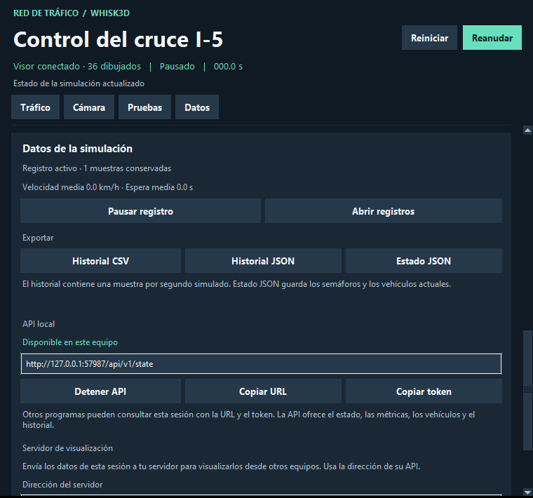

# FTI · Variante experimental con Whisk3D y Python

**Experimental, en desarrollo y sujeta a cambios.** Esta variante permite
probar la simulación y las integraciones de datos desde código fuente.

## Inicio

1. Usa Windows de 64 bits con Python 3.10 o superior, Tkinter, OpenGL y el
   runtime de Microsoft Visual C++ de 64 bits.
2. Abre **INICIAR-FTI.pyw**. También puedes ejecutar `python launcher.py`
   desde esta carpeta.
3. Configura la sesión y pulsa **Iniciar sesión**.

La simulación y el panel usan la biblioteca estándar de Python. El servicio
de servidor tiene sus dependencias en `servidor/requirements.txt`.

Las preferencias, los registros y las exportaciones se guardan en
`%LOCALAPPDATA%\FTI`. Puedes elegir otra carpeta con `FTI_DATA_DIR` para
desarrollo y pruebas. El menú **Sesión** permite iniciar otra sesión y abrir
los registros. Al cerrar se guarda una exportación de la sesión.

## Recorrido

- [LEEME.md](LEEME.md) explica escenarios, estrategias, cámara y controles.
- [API.md](API.md) describe el contrato de datos y los puntos de ampliación.
- [servidor/LEEME.md](servidor/LEEME.md) explica la API externa y su despliegue.
- [docs/ARQUITECTURA.md](docs/ARQUITECTURA.md) presenta lenguajes, herramientas y módulos.
- [docs/ESTADO-Y-PENDIENTES.md](docs/ESTADO-Y-PENDIENTES.md) separa lo disponible de lo pendiente.
- [docs/PRUEBAS.md](docs/PRUEBAS.md) permite repetir las comprobaciones.
- [docs/VISOR-WHISK.md](docs/VISOR-WHISK.md) identifica la versión del visor y su parche.
- [NOTICE.md](NOTICE.md) reúne procedencia y avisos de licencia.

## Organización del código

| Elemento | Responsabilidad |
| --- | --- |
| `INICIAR-FTI.pyw`, `launcher.py` | Inicio gráfico y ciclo de sesiones |
| `iniciar.py` | Coordinación de Python, visor y datos |
| `panel.py` | Controles y estado de la interfaz |
| `simulacion.py`, `trafico.py`, `geometria.py` | Reloj, circulación y colisiones |
| `semaforos.py`, `traffic_coordinator.py` | Control por cruce y prioridades de red |
| `canal_local.py`, `escena/control.lua` | Enlace Python–Whisk3D |
| `datos.py`, `api_local.py`, `conector.py` | Muestreo, consultas locales y publicación |
| `servidor/` | API externa y almacenamiento |
| `flota.json`, `modelos-originales/`, `escena/` | Catálogo y recursos visuales |
| `whisk3d/` | Visor nativo, recursos, parche y licencias |
| `verificar*.py` | Comprobaciones automatizadas |

## Alcance de la entrega

Incluye el visor Whisk3D de Windows, las once mallas originales y sus
conversiones. El launcher y la simulación se ejecutan con el Python instalado.
La API de servidor puede ejecutarse en Linux o Windows y requiere configurar
su destino y sus credenciales. Las comprobaciones de publicación se describen
con sus límites en la guía de pruebas.
