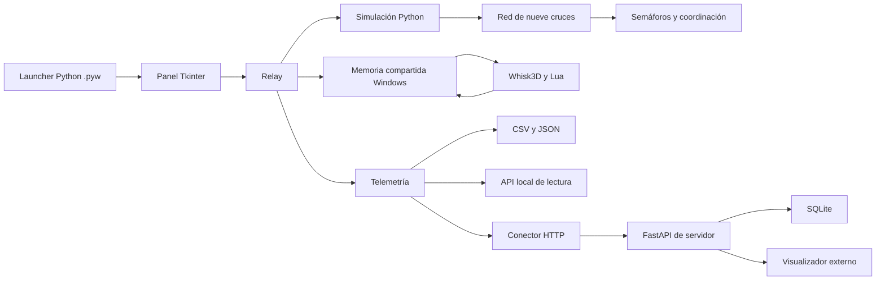

# Arquitectura de la variante experimental

Python mantiene el estado de la simulación. Whisk3D recibe poses y semáforos
para dibujar el cruce I-5. Los datos se exponen a través de módulos propios
que permiten incorporar otras consultas y visualizadores.

## Flujo de ejecución

## Módulos y puntos de extensión

| Archivo | Responsabilidad | Ampliación habitual |
| --- | --- | --- |
| `launcher.py` | Preferencias iniciales y ciclo de las sesiones | Nuevos perfiles o servicios de inicio |
| `panel.py` | Controles, confirmaciones y acciones de datos | Nuevos controles e indicadores |
| `iniciar.py` | Relay, ciclo de actualización y unión de módulos | Campos en `Relay._publish_data` |
| `simulacion.py` | Reloj y aplicación ordenada de comandos | Nuevas acciones de simulación |
| `trafico.py` | Nueve cruces, circulación y transferencias | Demanda, seguimiento y reglas de tráfico |
| `geometria.py` | Carriles, trayectorias y SAT | Geometría de una red distinta |
| `semaforos.py` | FTI, adaptativo, fijo y fase peatonal | Reglas de selección y tiempos |
| `traffic_coordinator.py` | Prioridades por demanda y congestión | Otros criterios de coordinación |
| `canal_local.py` | Tramas, confirmaciones y entradas del visor | Evolución del protocolo local |
| `escena/control.lua` | Luces, poses, interpolación y cámara | Opciones visuales del visor |
| `datos.py` | Instantáneas, historial y exportaciones | Nuevas columnas o agregaciones |
| `api_local.py` | API HTTP local autenticada | Consultas de diagnóstico |
| `conector.py` | Publicación de la última instantánea y reintentos | Otro destino o transporte |
| `servidor/app.py` | Recepción y consulta externa | Endpoints y validación |
| `servidor/almacen.py` | Persistencia y deduplicación | Otro almacenamiento o retención |
| `configuracion.py` | Preferencias y directorios de datos | Configuración de nuevas funciones |
| `flota.json` | Dimensiones, colores y eje frontal de modelos | Nuevos vehículos |
| `escena/convertir_flota.py` | STL, orientación, materiales y UV | Acabado de nuevos modelos |
| `escena/generar.py` | Escena y plantillas del visor | Nuevos nodos y recursos |

## Frecuencias y unidades

La lógica usa un paso fijo de 1/30 s y acota la recuperación tras una pausa
de la interfaz. El enlace visual publica aproximadamente a 20 Hz y Lua
interpola las poses. La telemetría actualiza la instantánea aproximadamente
a 10 Hz. El historial registra una muestra por segundo simulado observado.
El conector transmite aproximadamente una vez por segundo de reloj.

Las posiciones de la API se expresan en metros respecto de I-5, con X hacia
el este y Z hacia el sur. El rumbo usa radianes desde +Z hacia +X. Las
velocidades se transmiten en km/h y las esperas en segundos. El campo
`simulation.units` describe la convención.

## Integración local

El canal Python–Whisk3D usa memoria compartida y sincronización de Windows.
Cada proceso del visor recibe un canal de sesión. La recuperación renueva
el canal y descarta confirmaciones y acciones del proceso anterior.

Los comandos de interfaz se aplican sobre el estado de Python. El visor
confirma el ciclo y el comando que dibujó. `viewer.connected` expresa la
conectividad, y `viewer.synchronized` permite comprobar la confirmación del
estado actual.

## Datos y servidor

El contrato JSON usa `schema_version: "1.0"`, `session_id`, `sampled_at`,
`simulation` y `viewer`. Los reinicios de escenario aumentan `epoch`.
La identidad de los vehículos se conserva durante las transferencias.

El emisor añade `delivery_sequence`. El servidor confirma las entregas y
conserva la secuencia por sesión para que un reintento o una entrega antigua
no reemplacen el estado. El historial se guarda en SQLite y tiene una
capacidad configurable.

La API local permite lecturas con token de sesión. El servidor usa
`FTI_API_TOKEN` para recepción y admite `FTI_READ_TOKEN` para consultas
externas. `FTI_CORS_ORIGINS` define los orígenes web autorizados. El destino
remoto requiere HTTPS. Los ejemplos y la instalación están en
[API.md](../API.md) y [la guía de servidor](../servidor/LEEME.md).

## Lenguajes y herramientas

| Tecnología | Participación en esta variante |
| --- | --- |
| Python 3.10 o superior | Lógica, interfaz, conversión, datos y servicios |
| Python 3.14.5 | Intérprete utilizado en las comprobaciones registradas |
| Tkinter y Tcl/Tk | Interfaz de escritorio, navegación y diálogos |
| Lua | Control de la escena de Whisk3D |
| C++17 | Código del visor y parche de integración |
| OpenGL y SDL2 | Renderizado y ventana nativa |
| FastAPI y Uvicorn | API del servidor |
| SQLite | Persistencia incorporada en el módulo servidor |
| HTTP, JSON y CSV | Transporte, contrato y exportación |
| STL binario y OBJ/MTL | Mallas originales y recursos convertidos |
| PNG | Texturas compartidas y capturas |
| Git y PowerShell | Control de versiones y comprobaciones |
| CMake, Ninja y MSVC | Compilación del visor incluido |

Las dependencias del servidor están fijadas en
[`servidor/requirements.txt`](../servidor/requirements.txt). El launcher y la
simulación de escritorio usan la biblioteca estándar de Python. El flujo de
conversión de la flota se implementa en Python y los resultados se verifican
visualmente en Whisk3D.

## Recursos y configuración

La escena incluye una plantilla por modelo y reutiliza instancias según
la flota que llega al cruce. El catálogo contiene once modelos, incluida
la moto y dos buses distintos. Se revisaron la dirección frontal y las
tapas de las ruedas históricas. Dos texturas pequeñas se comparten entre
los materiales que las utilizan.

Los archivos de aplicación se leen desde la carpeta de la variante. Las
preferencias y salidas se guardan en `%LOCALAPPDATA%\FTI`, o en la carpeta
indicada por `FTI_DATA_DIR`. Los tokens del conector duran la sesión.
